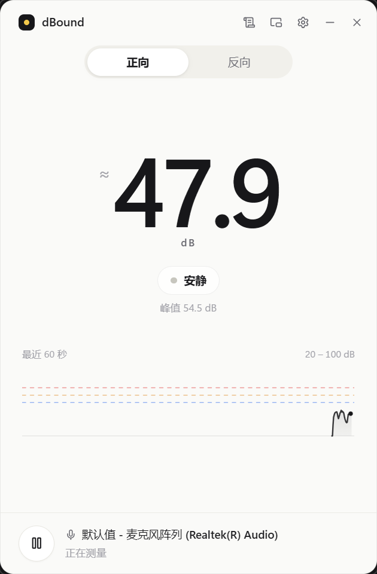
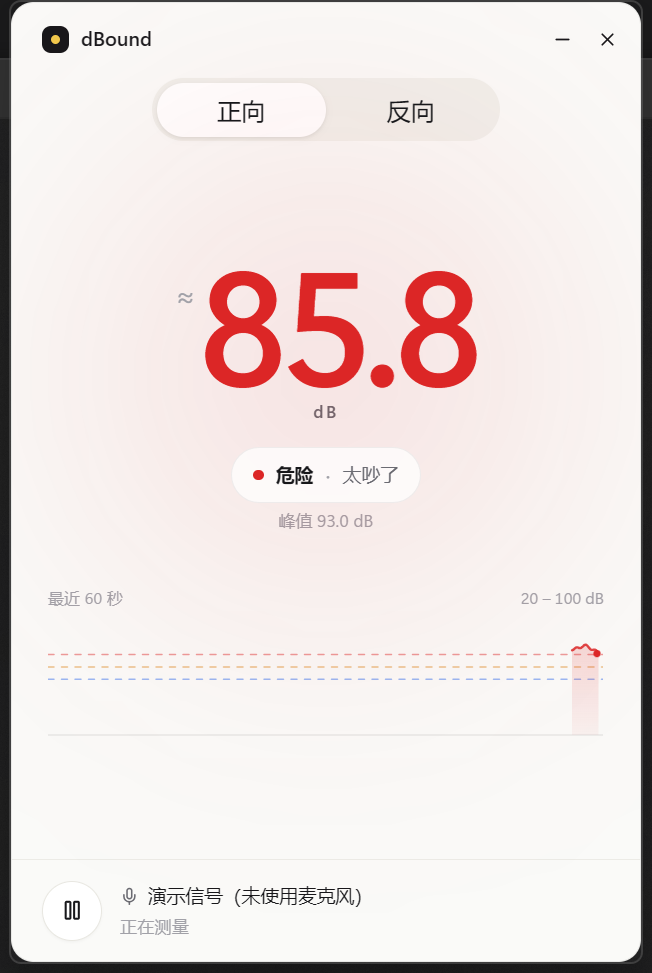
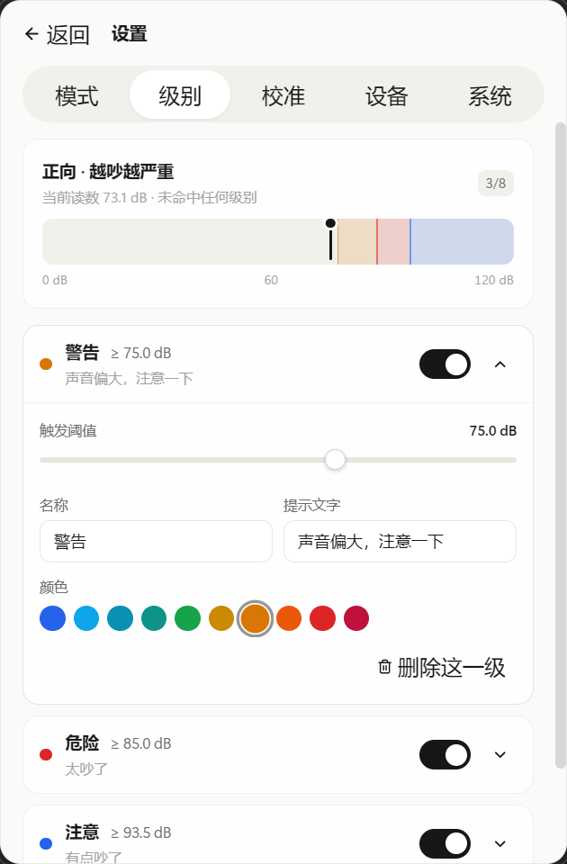
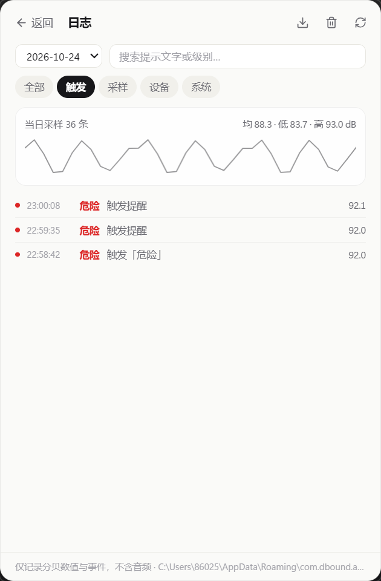
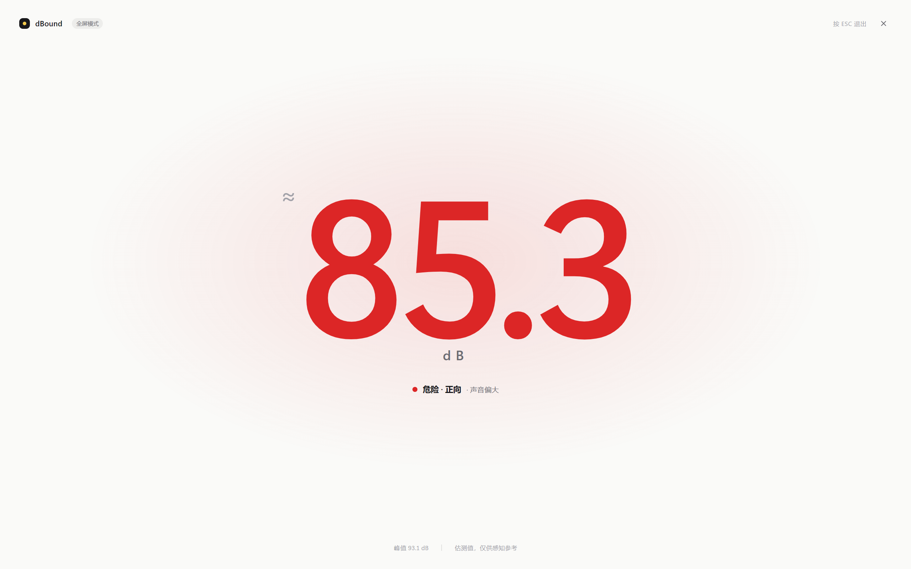
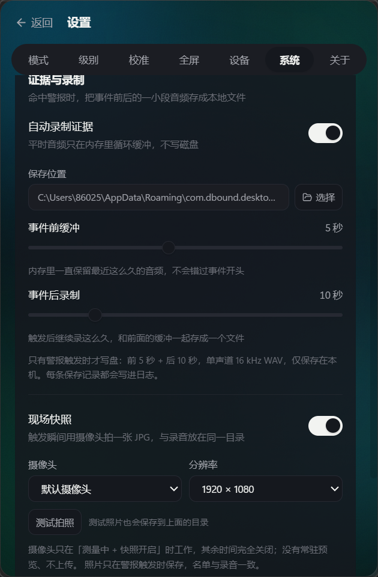
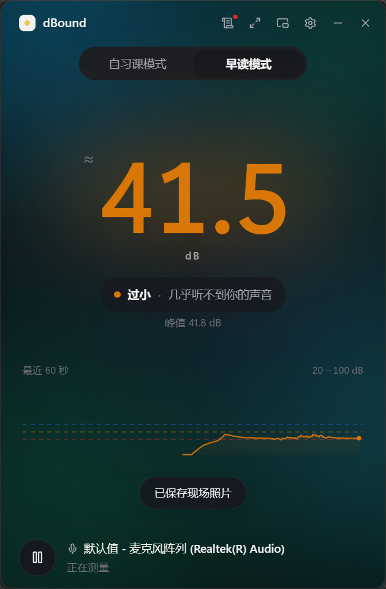
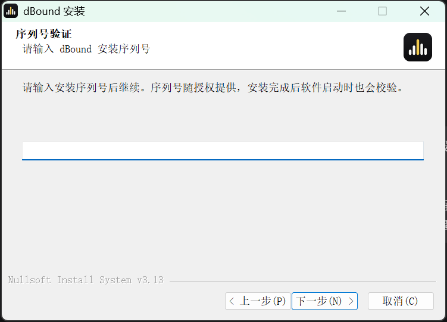
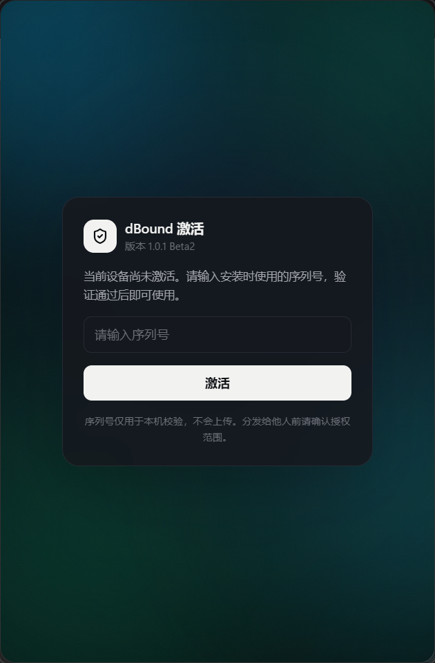

# dBound

**桌面音量哨兵** —— 用麦克风实时估测环境响度，太吵或（朗读时）太小声，一眼就能看见。

Windows 10 1809+ / Windows 11 · Tauri 2 + React 19 + TypeScript · 当前版本 **1.0.1 Beta2**



## 它能做什么

- **实时估测分贝**：中央超大读数 + 60 秒波形 + 3 秒峰值，30 Hz 刷新
- **两种模式**
  - 正向：声音**太吵**时按级别提醒（办公室、自习、邻居装修）
  - 反向：声音**太小声**时按级别提醒（朗读 / 配音 / 会议防静音），默认带 3 秒朗读平滑
- **1–8 级自定义警报**：每级独立阈值、名称、提示文字、颜色；实时阈值刻度条预览
- **模式可改名**：把正向 / 反向改成「自习课模式」「早读模式」，界面、全屏、日志同步
- **外观主题**：极光 / 薄荷两套浅色柔光渐变背景，另有暗黑模式，设置里一键切换
- **读数动效**：滚筒式翻页数字，滚动时长与刷新间隔可调（默认 600ms 滚动 / 1s 刷新）
- **仅视觉的提醒**：数字、光晕、波形、标题胶囊同步换色 + 柔和呼吸环，不发声、不弹窗
- **迷你胶囊窗**：158×58 置顶小窗，主窗隐藏时仍在角落刷新，点一下回主窗
- **证据与录制**：内存中循环缓冲最近 5 秒音频，命中警报时自动保存「前 5 秒 + 后 10 秒」
  的单声道 16 kHz WAV 到可配置目录；平时不写盘、不上传
- **现场照片**：可选开启摄像头快照，警报触发瞬间抓一张 JPG，与录音同名同目录；
  摄像头只在「测量中 + 快照开启」时工作，无预览、不上传，摄像头不可用时有明确提示
- **按模式留证**：证据录制 / 照片可按「自习课模式」「早读模式」分别开关，例如只在自习课留证
- **未命中样式**：大数字在未命中任何级别时的颜色可自定义（主界面与全屏同步）；状态文字「安静 / 音量正常」可改内容、字体、字号、颜色
- **级别文字大小**：命中级别时，主界面胶囊与全屏状态行里的「级别名称 / 提示文字」字号可分别调整，
  且名称、提示文字的颜色会跟随该级别颜色（与分贝数同色）
- **全屏模式**：整屏巨大读数 + 级别配色，适合演讲 / 课堂 / 朗读打卡投屏；F11 进入、ESC 退出，
  鼠标静止 3 秒自动隐藏顶部与底部信息；左上角标题 / 副标题可改文字、字体、字号、颜色
- **表情互动**：全屏达标后底部随机蹦出 Win11 表情（弹入 + 轻微弹跳），可配置每个模式的触发分贝、
  持续时长与初始数量，最多 80 个
- **托盘常驻**：关闭主窗进托盘，托盘菜单可快速切主窗 / 迷你窗 / 退出
- **校准**：偏移量滑杆 + 「安静环境校准」+「朗读校准」两种一键校准
- **日志中心**：触发事件 + 每秒采样，应用内按日期/类型查看、搜索、导出 CSV

> **关于精度**：读数由麦克风 RMS 换算为 `dB = 20·log10(rms) + offset`，用于比较响度的相对大小，
> 不是声级计的计量结果。不同麦克风之间差 10 dB 很正常，请用「校准」对齐到你的使用场景。

## 截图

| 命中「危险」 | 级别编辑器 |
| --- | --- |
|  |  |

| 日志中心 | 迷你胶囊 |
| --- | --- |
|  |  |

全屏模式（F11 / 标题栏 ⛶ 进入，ESC 退出）：



## 快速开始

环境要求：Node.js 20+、pnpm、Rust 1.77+、Microsoft Visual Studio C++ 生成工具、WebView2 运行时。

```powershell
pnpm install
pnpm tauri dev          # 开发（Vite 热更新 + Tauri 窗口）
pnpm tauri build        # 生成 release 版本 + NSIS 安装包
```

> 本机若 cargo 走清华镜像且报 `CRYPT_E_REVOCATION_OFFLINE`，
> 构建前执行 `$env:CARGO_HTTP_CHECK_REVOKE = 'false'`。

### 无麦克风预览界面

```powershell
$env:VITE_DBOUND_SIM='72'            # 合成 72 dB 信号
$env:VITE_DBOUND_SIM_MODE='forward'  # forward | reverse
pnpm tauri build --debug --no-bundle
```

## 安装（Windows 安装包）

发布包：`release/dBound_1.0.1_x64-setup.exe`

1. 运行安装包，**安装过程中必须输入序列号**（序列号 `142857`）。
2. 安装向导支持**自定义安装目录**（默认 `%LOCALAPPDATA%\dBound`）。
3. 安装完成后是完整的软件文件夹，而不是单个 exe：

   ```
   dBound\
     dbound.exe
     uninstall.exe
     license.dat
     文档\
       使用说明.txt
       版本信息.txt
       LICENSE.txt
   ```

4. 安装器会写入激活标记；首次启动软件会再次校验。把安装目录直接拷贝到别的电脑后，
   软件会要求重新输入序列号激活。
5. 静默安装（批量部署）：`dBound_1.0.1_x64-setup.exe /S /SERIAL=142857 /D=C:\dBound`
   （`/D` 必须是最后一个参数；不传或序列号错误时安装会以错误码 2 退出）。

| 证据录制与现场快照 | 快照触发提示 |
| --- | --- |
|  |  |

| 安装向导（序列号页） | 首次激活界面 |
| --- | --- |
|  |  |

> 关于页：设置 → 关于，可查看版本（1.0.1 Beta2）与作者信息（设计 / 创意 / 开发 | 作者：Source X）。

## 使用

1. 首次启动会自动开始测量（系统要求一次点击时，界面会提示「开始测量」）
2. 顶部切换**正向 / 反向**
3. 齿轮进设置：模式、级别、校准、全屏、设备、系统、关于
4. 标题栏 ← 日志 查看事件与采样记录
5. 标题栏 ⧉ 切到迷你胶囊；关闭主窗则收进托盘
6. 标题栏 ⛶ 或按 **F11** 进入全屏模式，按 **ESC** 退出

## 目录结构

```
src/
  components/        主界面组件（读数、波形、模式开关、标题栏）
  components/settings 设置面板（级别编辑器、校准、设备、系统）
  hooks/useLevelMonitor.ts  采集 + 平滑 + 报警 + 日志的编排
  lib/audio/capture.ts      Web Audio 采集链路
  lib/dsp.ts                RMS→dB、时间加权、级别判定、校准
  lib/alertEngine.ts        dwell / hysteresis / exitDwell 状态机
  lib/logger.ts             批量落盘、CSV 数据准备
  pages/                    Main / Settings / Logs / Mini
  stores/                   zustand 设置与实时状态
src-tauri/
  src/lib.rs                托盘、迷你窗、窗口事件
  src/logs.rs               JSONL 日志写入、按天滚动、清理、导出
scripts/                    图标生成、构建与自动化验收脚本
docs/                       PRD、进度、截图
```

## 数据与隐私

- 音频与照片只在本机处理：平时仅在内存中计算并循环缓冲；只有警报触发且开启「证据录制 / 现场快照」时，
  才把前 5 秒 + 后 10 秒写成 WAV、把触发瞬间存成 JPG，保存到你设置的目录；从不上传
- 设置保存在本机 WebView 的 localStorage
- 日志只包含分贝数值与事件文本，位于
  `%APPDATA%\com.dbound.desktop\logs\YYYY-MM-DD.jsonl`，保留 7 天 / 20 MB

### 关于麦克风授权

应用窗口使用 `--use-fake-ui-for-media-stream` 参数，让打包后的 WebView2 直接放行**本地页面**的
麦克风请求，避免首次启动时出现一个浏览器样式的授权气泡而测量卡在「启动中」。
窗口只加载应用自带的本地资源，不加载任何远程页面；若 Windows 系统级的「允许桌面应用访问麦克风」
被关闭，应用仍会显示明确的错误提示并引导到系统设置。

## 已知限制

- Windows only（Win10 1809+ / Win11 x64）
- 估测值受麦克风、系统增益、距离影响；未做 A 计权与频响补偿
- 开机自启与全局快捷键暂未接入
- 未提供自动更新

## 技术栈

Tauri 2 ｜ React 19 ｜ TypeScript ｜ Vite ｜ Tailwind CSS v4 ｜ zustand ｜
Web Audio API（AnalyserNode + RMS）｜ cpal 未使用，采集完全在前端完成 ｜
tauri-plugin-window-state / dialog

## 作者

设计 / 创意 / 开发 | 作者：Source X

## License

MIT（源码）；分发的安装包受《dBound 软件许可说明》约束，需授权序列号使用。
